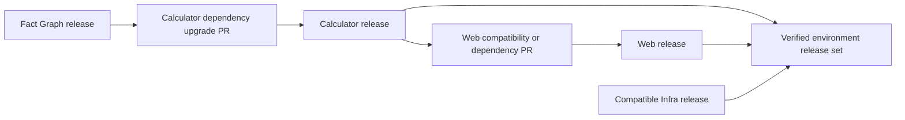

# TaxAdvisor release process

This policy covers `fact-graph`, the `tax-advisor` calculator, `TaxAdvisor`, and
`TaxAdvisor-Infra` in the `qcloop` repositories. Each has its own version and
release approval. A deployment records the exact combination that runs together.
Feature merges accumulate on `main`; a reviewed release PR selects the next
version; AWS approval authorizes deployment of a specific verified artifact.

The application release flow is: feature PRs → `main` → release PR → immutable
tag → qualified image → reviewed change set → AWS approval → deployment →
functional acceptance and release record.

**Status:** Process defined; release automation changes require the rollout below.
The [2026-11-17 baseline](release-baseline-2026-11-17.md) distinguishes existing
controls from changes still to implement. The current AWS pipelines continue to
watch `main` until their trigger configuration is deliberately changed.

## Release units and ownership

| Release unit | Repository and version source | New tag format | Published artifact |
| --- | --- | --- | --- |
| `fact-graph` | `qcloop/fact-graph`; `build.sbt` `factGraphVersion` | `vX.Y.Z` | JVM JAR and POM, sources, and Scala.js distribution with SHA-256 checksums |
| `tax-advisor` | `qcloop/direct-file`; `direct-file/tax-advisor/pom.xml` project version | `tax-advisor-vX.Y.Z` | ARM64 calculator image in the existing calculator ECR repository, including pinned tax knowledge |
| `TaxAdvisor` | `qcloop/TaxAdvisor`; root `package.json` version | `vX.Y.Z` | ARM64 web/API/agent image in the existing web ECR repository |
| `TaxAdvisor-Infra` | `qcloop/TaxAdvisor-Infra`; introduce a release-managed `version.txt` | `vX.Y.Z` | Checksummed CloudFormation templates, policies, schemas, configuration and trusted delivery-script bundle |

JVM and JavaScript outputs share one Fact Graph version. TaxAdvisor workspace
packages ship together in the web image; their internal package versions do not
become independent product releases. The calculator release covers its shared
parent, libraries, graph resources and tax-knowledge dependency closure inside
Direct File. It does not version the other Direct File services.

The component maintainer owns code, tests, compatibility notes and the release PR.
The release manager checks scope, version and publication evidence. The AWS
approver reviews the exact digest and change set; build and deployment automation
cannot approve. The Infra maintainer owns delivery logic, environment configuration,
release records and recovery. Name the responsible people in each release record;
the pilot operator may hold multiple roles. Production requires a reviewer other
than the change author.

Infra versions describe deployment code and contracts. Recording a newly deployed
image pair in `manifests/pilot.json` is release bookkeeping and does not by itself
require another Infra version or application rebuild.

## Development and version policy

Use protected `main` with short-lived `feature/*` and `fix/*` branches, PR review,
passing required checks and squash merges. Use Conventional Commit PR titles so
the squash commit describes the change. Block force pushes and branch deletion;
restrict release tag creation to release automation and block tag updates/deletion.
Feature flags keep incomplete work from making `main` unsafe to release.

| Change | Version effect |
| --- | --- |
| `fix:` or `fix(calculator):` | PATCH for a compatible correction |
| `feat:` or `feat(web):` | MINOR for a compatible capability |
| `feat!:` or a `BREAKING CHANGE:` footer | MAJOR at 1.0 or later |
| `docs:`, `test:`, `ci:`, `chore:` | No release by themselves |

For `0.x` applications, explicitly configure breaking changes to increment MINOR
and compatible features to increment MINOR; fixes increment PATCH. Configure
Release Please with `bump-minor-pre-major: true` and
`bump-patch-for-minor-pre-major: false`. These pre-1.0 rules do not apply to Fact
Graph 3.x. A supported public contract is the criterion for choosing 1.0, rather
than deployment to the pilot.

Dependency, base-image, model, prompt, tax-rule and infrastructure changes that
alter delivered behavior must carry an appropriate `fix:`, `feat:` or breaking
signal. Do not hide a required release behind `chore:`. For Infra, a breaking
deployment/configuration contract is MAJOR, an additive capability is MINOR, and
a compatible correction is PATCH.

Only the release PR changes the component's own version and changelog. Dependency
upgrade PRs may change the versions/checksums of consumed components. Never move,
reuse or recreate a published tag or overwrite the bytes of a published version.

## Release PR and publication

Use Release Please manifest mode on `push: main`, with one open release PR per
release unit. Multiple feature PRs contribute to that PR without publishing a
release. Review the proposed version, complete changelog, compatibility changes,
test evidence and dependency changes before merging. Release Please owns the
version update, changelog, tag and GitHub Release; AWS retains delivery ownership.
[Release Please documents these responsibilities and its tag/SHA outputs.](https://github.com/googleapis/release-please-action)

Configure the version updaters as follows:

- **Fact Graph:** `simple` strategy with a new `version.txt`, kept equal to
  `factGraphVersion` through a generic updater annotation on that constant in
  `build.sbt`. Verify both cross-project versions match the release tag.
- **Calculator:** one root-scoped release unit in `qcloop/direct-file`, component
  `tax-advisor`, using `simple` with a new
  `direct-file/tax-advisor/version.txt` and a targeted XML updater for the service's
  project version. Root scope deliberately includes shared libraries, the parent
  POM and tax knowledge. A subdirectory-only release configuration would miss
  some of these changes. Do not rewrite unrelated modules or the parent's own
  version. Make JAR packaging independent of the current hardcoded
  `tax-advisor-0.0.1.jar` before enabling version bumps.
- **TaxAdvisor:** `node` strategy at the repository root; update the root package
  version and verify the pnpm lockfile remains consistent. Internal workspace
  versions stay independent of the product version unless packaging requires them.
- **Infra:** `simple` strategy with a new `version.txt`; package the authored
  templates and the trusted scripts from the same release commit.

Scope the calculator XML update to the project version, excluding parent and
dependency versions. Test namespace-aware POM handling in a release PR. Generic
and XML version-file updaters are supported by
[Release Please customization](https://github.com/googleapis/release-please/blob/main/docs/customizing.md).

Use a dedicated GitHub App installation token with only the repository permissions
Release Please requires. Bot release PRs must run the same checks as human PRs.
The default `GITHUB_TOKEN` suppresses most downstream Actions events; bot-created
PR runs can require approval. Do not depend on a suppressed tag/release workflow.
The dedicated App is the chosen automation identity; verify its events in a test
repository before enabling delivery.
[GitHub documents the token event rules.](https://docs.github.com/en/actions/concepts/security/github_token)

For every publication, use the release output's exact tag and SHA, verify the tag
resolves to that SHA and that it is the reviewed release PR merge, and build that
snapshot. Advancing `main` must not change the build input. Pin Actions to reviewed
commit SHAs. PR checks receive no AWS deployment credentials or release write token.

## Artifact identity and dependency upgrades

Publish Fact Graph's JVM and Scala.js assets once to its GitHub Release, accompanied
by a checksum manifest and source SHA. This is the initial package distribution
target; a Maven registry can be introduced later through a separate decision.
Calculator builds download the released JVM JAR/POM, verify the recorded SHA-256
checksums and install those exact bytes into a fresh Maven repository. They must
not rebuild an arbitrary graph commit and label it with an existing version.

During migration, a pinned graph source archive remains acceptable only as an
explicit transitional dependency: record its version, full SHA and archive
checksum, verify the tagged identity and run the graph checks. Move PR CI and AWS
CI together to the released binary. One dependency lock in the calculator source
must supply both build paths; Infra's trusted verifier validates that lock and
does not maintain a second independent graph pin. Changes to trusted verification
logic still require an Infra release.

The dependency order is:

Only changed components release. A Fact Graph release does not automatically
rebuild or deploy its consumers. A compatible calculator update can ship without
a web release. Deploy additive MCP capabilities before a web release that uses
them; remove old contracts only after all consumers have migrated. For breaking
changes, use an explicit compatibility/migration plan rather than assuming the
two independently approved pipelines switch atomically.

Pin the tax-knowledge release ID, content hash, tax year and review status in the
calculator release evidence. Record state/persistence compatibility and supported
MCP contracts. A code release or AWS approval does not establish tax-content
approval. The pilot's explicit draft-artifact allowance is recorded as a pilot
exception. Broader production use requires the content manifest's required
reviews, or a separately recorded policy decision by the accountable owner.

Pin container base-image digests and relevant build inputs when implementing
publication. Existing mutable base tags and package-update steps can produce
different bytes on a rebuild; source SHA alone is insufficient identity.

## AWS delivery and promotion

Keep the existing CodeConnections → CodePipeline V2 → ARM64 CodeBuild → ECR →
CloudFormation/ECS delivery design, `QUEUED` executions, SNS email approval and
separate build, prepare and deploy roles. Retain the content-addressed,
checksum-verified Infra script bundle in preparation/deployment jobs.

The target delivery triggers are **release tags only**:

| Pipeline | Repository | Tag filter |
| --- | --- | --- |
| `taxadvisor-pilot-web-delivery` | `qcloop/TaxAdvisor` | `v*` |
| `taxadvisor-pilot-calculator-delivery` | `qcloop/direct-file` | `tax-advisor-v*` |

Replace the existing `main` push filters; do not add tag filters alongside them.
Disable default branch change detection. The glob filters are routing rules;
trusted verification must also reject tags outside the exact SemVer namespace,
unreviewed/manual tags and versions that differ from the checked-out metadata.
AWS supports tag-filtered CodeConnections sources.
[CodePipeline trigger documentation](https://docs.aws.amazon.com/codepipeline/latest/userguide/pipelines-triggers.html)

Bind the triggering tag to `Source.CommitId` and the release record. Existing
`CODE_ZIP` source artifacts do not contain a Git checkout. Implement authenticated
repository-metadata verification or supported full-clone source mode; do not
assume a ZIP contains `.git` or invent a source-action tag output. Manual starts
and recovery runs must name and verify the release identity; they cannot default
silently to current `main`.
[AWS describes source artifact formats and output variables.](https://docs.aws.amazon.com/codepipeline/latest/userguide/action-reference-CodestarConnectionSource.html)

For each deployable release:

1. Validate release identity, run component qualification, build the ARM64 image,
   publish to the existing immutable ECR repository and record its digest.
   Require a completed scan with zero HIGH/CRITICAL findings. Keep application
   dependency/static analysis alongside OS scanning.
2. Establish a canonical mapping from component/version to tag, SHA and artifact
   checksum/digest. Create it once with conditional-write semantics. An existing
   identical mapping is reusable; a conflicting mapping fails publication.
   Current commit-plus-build-ID image tags alone do not enforce this rule.
3. Qualify the candidate in the target non-production environment. Once separate
   staging and production exist, deploy and test the **same digest** in staging
   before requesting production approval. Copying images between registries must
   preserve and verify content identity; promotion never rebuilds them.
4. Prepare the existing image-only CloudFormation change set with the current
   template/parameters. Record its ID, template hash, previous image and stack
   update identity. Reject unrelated resource changes or service replacement.
5. Email the approver the component, version, tag, SHA, digest, scan result,
   qualification evidence, compatibility/knowledge status, rollback target and
   change-set link. The approver signs in to AWS to approve the exact candidate.
6. Recheck scan and stack freshness, execute the same approved change set, then
   verify deployed digest, completed ECS rollout, healthy tasks and readiness.
   A stale change set requires fresh preparation and approval of the same
   artifact, without rebuilding it.
7. Complete functional acceptance and the observation period. Record success
   only for the state actually verified; reconcile the environment manifest.

Only `pilot` currently exists in the inspected configuration. Treat its public
deployment as an approval-gated live environment. Image/isolated integration
checks precede approval; synthetic end-to-end acceptance follows deployment.
Do not report a separate staging promotion until that environment is provisioned.
Production rollout is blocked until staging, restore testing, access policy,
availability expectations and tax-content policy are resolved.

Infrastructure changes follow their own release PR, tagged bundle, validation,
reviewed account-aware change set and explicit operator approval. Application
pipeline roles retain image-only permissions. Deploy compatible foundation
changes before dependent applications. Reconcile live image parameters before
an Infra update so a stale Git manifest cannot roll an application backward.

## Qualification and release records

Run the established commands from each repository root:

| Component | Qualification |
| --- | --- |
| Fact Graph | `make ci_format_check ci_test`; publish JVM packages and full Scala.js distribution from the same SHA; additionally verify constructor/factory exports against the final linked distribution |
| Calculator | `bash .github/scripts/test-mcp.sh`; Docker build using `direct-file/tax-advisor/Dockerfile` and `direct-file` context; `.github/scripts/smoke-mcp.py` against that image; require Redis tests to execute and pass |
| TaxAdvisor | `pnpm install --frozen-lockfile`, `pnpm lint`, `pnpm typecheck`, `pnpm test` with isolated Redis, and `pnpm --filter @taxadvisor/web... build`; smoke-test the final ARM64 image |
| Infra | `python3 scripts/check.py`; pinned-tool `python3 scripts/validate.py`; regenerate the pipeline template when its generator changes and require a clean generated diff |

Record dependency versions/checksums, toolchains, platform, security results and
test reports with the artifact. A library change also requires downstream
calculator qualification before that dependency upgrade is released.

Functional acceptance covers MCP discovery, synthetic intake and QBI cases,
editing/what-if comparisons, saved-state recovery, session isolation, Start over,
and a bounded Bedrock streaming request. Use synthetic sessions. Re-run browser
flows when UI/session behavior changes; test replacement/restore when state or
infrastructure changes. Health checks alone do not prove these behaviors.

For the pilot, observe at least 15 minutes after acceptance, checking service
health, error/timeout logs, failed calculations and model/budget failures. A
failed acceptance check, unhealthy rollout or new sustained errors blocks
completion and starts recovery. Production must define workload-specific alarm
thresholds and its observation window before launch.

Keep three distinct records:

| Record | Required identity and state |
| --- | --- |
| Component release | Component, version, tag, full source SHA, artifact URI/digest/checksums, build ID, dependencies, platform, qualification/security evidence; `tagged`, `artifact-ready` or `failed` |
| Deployment attempt | Environment, release identity, Infra tag/SHA and script-bundle hash, configuration/model identity, change-set ID, pipeline execution, previous artifact, approver/time, verification and result |
| Environment release set | Unique environment/time ID; exact web and calculator releases/digests, embedded graph/knowledge identities, Infra revision, configuration/model identity, last verified deployment and rollback reference |

The existing S3 `releases/<component>/<build-id>.json` records and versioned
`current/<component>.json` pointers remain the runtime evidence. Extend their
schemas for release identity, approval and functional acceptance; retain failed
attempt evidence separately. A pointer must not present a failed or merely
health-verified attempt as fully accepted.

`TaxAdvisor-Infra/manifests/pilot.json` currently accepts image/source pairs and
Bedrock configuration, with `draft`/`ready` configuration status. That status does
not prove deployment success. Add a separately validated release-set record or
deliberately migrate the schema; do not insert unrecognized fields into it.
Run `scripts/sync-release-manifest.py` after verified pipeline deployment, review
the diff and commit the reconciliation. Keep the unchanged component's identity.
S3 versioning is recovery support; use write-once publication controls for the
canonical artifact map and append-only deployment attempt history.

## Hotfixes, rollback and recovery

When `main` is safe, merge a minimal `fix:` PR and release normally. Review all
pending changes: an emergency fix does not make a mixed release PR patch-only.

When `main` is unsafe, branch from the deployed release tag. Use a separately
reviewed maintenance-release configuration/workflow targeting that branch, apply
only the fix, qualify it and publish a fresh patch tag through the same artifact
and AWS approval gates. Configure the branch's previous release/version and tag
namespace explicitly. Do not assume the `main`-only Release Please workflow can
release it. Backport the fix into `main`, reserve the patch version across both
release streams and reconcile the next release PR to avoid version reuse.

Rollback redeploys the previous verified image digest with a new reviewed
image-only change set and approval. First check compatibility with the other
component, graph/knowledge version and persisted state. Restore the pair in the
safe dependency order when necessary; do not rebuild old source to roll back.
Record the rollback attempt and update the environment record only after checks.
The singleton MCP stops before replacement and interrupts transport sessions;
Redis planning state does not preserve in-memory MCP transport sessions.

For state changes, use backward-compatible expand/contract migrations and test
old/new readers before promotion. An incompatible state change requires a tested
restore or fix-forward procedure and an explicit interruption/data-loss decision.
Infrastructure rollback means reviewing a change set from a known-good bundle;
never assume reverting Git will safely undo a stateful replacement.

| Failure | Required response |
| --- | --- |
| Required checks fail | Block merge or publication |
| Wrong release version/scope | Correct the release PR before merge |
| Tag exists, artifact missing | Leave tag intact; resume exact-SHA publication if no canonical artifact exists; keep deployment blocked |
| Canonical artifact already exists | Reuse and reverify it; reject different bytes for the same version |
| Approval rejected/expired or stack changed | No deployment; prepare a new change set and obtain approval |
| Rollout fails | Inspect ECS/CloudFormation rollback and verify restored health before another attempt |
| Deployment succeeds, acceptance fails | Mark failed/unaccepted; prepare approved rollback or fix-forward; do not advance the accepted pointer |

Existing ECS/CloudFormation rollback protects rollout failures. Post-deployment
functional failure does not automatically authorize a second change set. A retry
of an already executed approved change set may collect evidence only if stack,
image, template and change-set identity still match. Preserve incident and failed
release evidence; create a new version for a code correction.

## Rollout and administrator prerequisites

Implement in this order, preserving the existing live approval boundary:

1. **Reconcile the baseline.** Confirm remote tags, GitHub Releases and deployed
   source/artifact identities. Preserve the existing bare `3.1.1` Fact Graph tag.
   Resolve its release-branch ancestry before bootstrapping `main`; do not invent
   a historical `v3.1.1`. The application metadata says `0.0.1` but does not prove
   a published release. Establish a documented first-release boundary/version
   for each application and Infra. Test the manifest/bootstrap SHA in dry run.
2. **Install repository release management.** Add Release Please configuration,
   correctly initialized manifests, changelogs, version-file integration and
   pinned workflows in each repository. Preserve existing CI, correct fork-specific
   Fact Graph checks, add conventional PR-title validation, and verify release PR
   checks and version-sensitive packaging. Publish Fact Graph assets first.
3. **Unify calculator dependency inputs.** Introduce the shared dependency lock,
   migrate PR/AWS builds to released JVM bytes, and release/deploy the updated
   trusted Infra bundle. Reconcile the stale local Infra pin with deployed logic.
4. **Implement release identity and recovery.** Add the canonical artifact map,
   extended evidence schemas, exact-tag/SHA validation, artifact reuse,
   maintenance-release path and tested previous-digest promotion without builds.
5. **Switch application delivery.** Test tag routing through the dedicated App
   and CodeConnections, then replace main triggers with release-tag filters and
   disable default branch detection. Resolve existing queued candidates under
   the old policy explicitly before cutover; do not interrupt or approve them
   as a side effect of configuring the new process.
6. **Exercise pilot recovery and future production.** Demonstrate approved
   previous-digest rollback, failed acceptance handling, manifest reconciliation
   and backup restore. Provision staging/production and their scoped roles and
   approval policies before claiming cross-environment promotion works.

An administrator must verify PR/review requirements, stable required check names,
squash merge settings, branch/tag rulesets, Actions App permissions/secrets and
any setting needed for automation to open PRs. Verify the GitHub plan supports
enforcement for each private repository. Where protection is unavailable, the
release manager checks reviews/CI manually and AWS retains its independent
build and approval gates; do not describe this as protected `main`.

Required existing job names are `MCP checks` for the calculator, `Web checks` for
TaxAdvisor, and `validate` for Infra. Fact Graph currently has `check-commit-emails`,
`build` and `security-scan`; repair and verify them on this fork before selecting
them as required checks. Capture the exact check contexts displayed by GitHub,
not just workflow titles. Include `merge_group` checks if a merge queue is enabled.

The release App credentials and AWS GitHub connection are different identities.
Verify repository access for both. Preserve the AWS approval SNS subscription,
separation of duties and scoped roles; GitHub Environment approval is not an
additional requirement for the existing AWS-owned deployment. If GitHub later
starts AWS operations directly, configure scoped OIDC credentials as a separate
reviewed integration rather than adding long-lived keys.

Before declaring automation operational, retain evidence that:

- Multiple feature/fix merges create no deployable AWS execution; a release PR
  aggregates them and applies the selected SemVer and correct version-file rules.
- Its merge creates one correct tag/release and one canonical artifact identity
  from the release SHA, even if `main` advances or publication is retried.
- Shared-library and tax-knowledge changes contribute to calculator release scope;
  unrelated Direct File tag namespaces cannot start calculator delivery.
- Bot PR checks run; the App-created tag reaches CodePipeline; malformed/manual
  starts, mismatched SHAs and conflicting artifacts fail closed.
- Rejected/stale approval, failed scan/build, failed rollout and failed acceptance
  cannot become a successful deployment record.
- Approved promotion and rollback use existing digests without a build; a
  maintenance patch can ship without unrelated `main` changes.

Workflow edits, GitHub admin configuration and AWS trigger changes are rollout
deliverables. This policy document does not imply that they have been installed.
